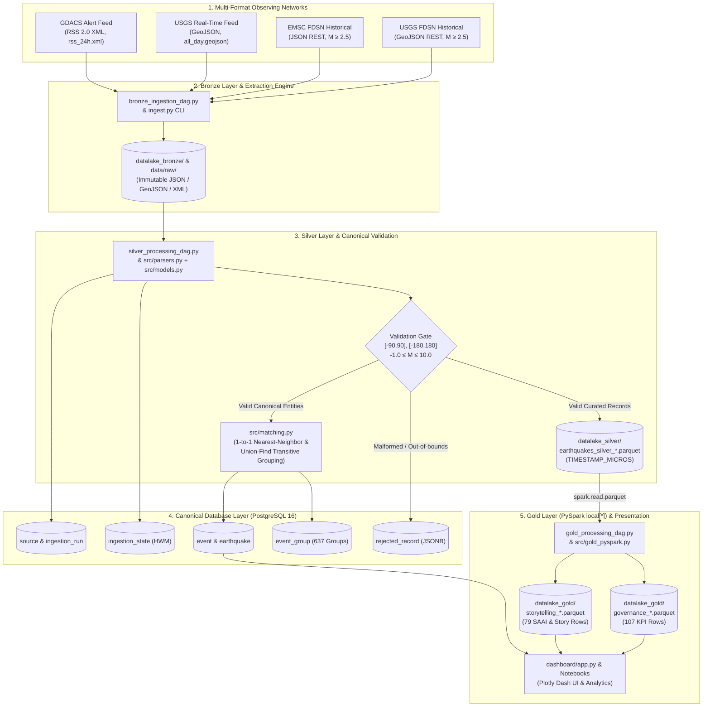

# Natural Hazard Monitoring System — Earthquake Activity Monitoring
**Course:** Programación para Análisis de Datos (Data Analysis Programming) — Semester 2026-II  
**Project:** Natural Hazard Monitoring Systems — **Team 1: Earthquake Activity**  
**Repository:** `earthquake-monitoring-team_1`  
**Team members:**
- Juan Córdoba - 20211020097
- Mauricio Sánchez - 20212020045
- Angelo Ibáñez - 20212020007

[]()
[]()
[]()
[]()
[]()
[]()
[]()

---

## 1. Executive Summary & Project Purpose

Earthquakes are sudden, high-consequence natural hazards caused by tectonic strain energy release along lithospheric faults. Unlike hydrometeorological phenomena, seismic ruptures cannot be predicted deterministically. Monitoring and civil protection depend on **near-instantaneous event detection**, **rapid multi-catalog telemetry reconciliation**, and **quantitative anomaly detection** to direct emergency response and civil defense operations.

This repository implements the end-to-end data engineering architecture for **Team 1**, standardizing and reconciling seismic telemetry from the world's leading seismological networks:
- **USGS (United States Geological Survey):** Global FDSN web services & real-time summary GeoJSON feeds.
- **EMSC (Euro-Mediterranean Seismological Centre):** European & Mediterranean FDSN seismic portal.
- **GDACS (Global Disaster Alert and Coordination System):** Multi-hazard emergency disaster alert feeds.

---

## 2. High-Level System Architecture

The system integrates a **Three-Layer Medallion Data Lakehouse** (`datalake_bronze/`, `datalake_silver/`, `datalake_gold/`) orchestrated by Apache Airflow 2.10.4 and PySpark (`local[*]`) with a **7-Table Canonical PostgreSQL Persistence & Reconciliation Engine** (`ingest.py` / `src/`). Multi-format raw payloads (GeoJSON, JSON, and RSS 2.0 XML) pass through strict schema and physical bounding gates, route malformed records to a `JSONB` quarantine table (`rejected_record`), resolve cross-catalog event duplication via **1-to-1 Nearest-Neighbor Spatio-Temporal Matching & Union-Find Transitive Grouping** (`event_group`), and consolidate into Gold Parquet summaries for data governance and functional user storytelling.



---

## 3. Geophysical Foundations & Domain Understanding

A detailed, peer-reviewed geophysical foundation is documented in [`docs/hazard_definition.md`](docs/hazard_definition.md):
- **Elastic Rebound Theory:** Tectonic strain accumulation, Coulomb frictional failure, and dynamic rupture propagation at shear velocities ($v_r \approx 0.85 v_s$).
- **Wave Propagation Modes:**
  - *Compressional ($P$) waves:* Longitudinal, fastest arrival ($v_p \approx 6 - 8\text{ km/s}$), travels through solids and liquids.
  - *Shear ($S$) waves:* Transverse, high kinetic energy ($v_s \approx 3.5\text{ km/s}$), strictly requires shear rigidity ($\mu > 0$, solids only).
  - *Surface waves (Rayleigh & Love):* Trapped in crustal waveguides, low attenuation ($\propto 1/\sqrt{r}$), dominant cause of high-rise structural resonance.
- **Hypocenter vs. Epicenter:** 3D focal coordinates $(x, y, z)$ vs. 2D surface geoid projection $(x, y, 0)$.
- **Focal Depth Regimes & PGA Attenuation:**
  - *Shallow ($0 - 70\text{ km}$):* High Peak Ground Acceleration (PGA), localized catastrophic destruction, tsunami generation potential.
  - *Intermediate ($70 - 300\text{ km}$):* Wadati-Benioff subduction zones.
  - *Deep ($> 300\text{ km}$):* Severe anelastic attenuation ($e^{-\omega R / 2vQ}$), low surface damage.
- **Magnitude Scale Saturation:** Body-wave ($m_b$) and local ($M_L$) scales saturate at $M \sim 6.0 - 6.5$ due to short-period 1-second filter limits. Moment magnitude ($M_w$) scales directly with physical seismic moment $M_0 = \mu A D$ without saturation.

---

## 4. Validated Source Payloads & Empirical Evidence

All four sources are fully configured in [`config/sources.yaml`](config/sources.yaml) and verified with multi-source raw sample payloads:

| Source ID | Institution | Format | Sample Payload File | Verified Records | Scope / Window |
|---|---|:---:|---|:---:|---|
| `usgs_fdsn` | USGS (NEIC) | GeoJSON | [`workshop_1/samples/usgs_historical_raw.json`](workshop_1/samples/usgs_historical_raw.json) | **618** | Global historical ($M \ge 4.5$, 1 month) |
| `emsc_fdsn` | EMSC | JSON | [`workshop_1/samples/emsc_historical_raw.json`](workshop_1/samples/emsc_historical_raw.json) | **627** | Matching global window ($M \ge 4.5$) |
| `usgs_realtime` | USGS | GeoJSON | [`workshop_1/samples/usgs_incremental_raw.json`](workshop_1/samples/usgs_incremental_raw.json) | **1,764** | Real-time rolling 7-day stream (`all_week`) |
| `gdacs_realtime` | GDACS (EU JRC) | RSS 2.0 XML | [`workshop_1/samples/gdacs_incremental_raw.xml`](workshop_1/samples/gdacs_incremental_raw.xml) | **25 (12 EQ)** | Active 24-hour disaster alert feed |

### Empirical Two-Poll Ingestion Characterization
Documented in [`workshop_1/polling_evidence.md`](workshop_1/polling_evidence.md):
- **Poll #1 (`05:33:48Z`):** 12 events captured from `all_hour.geojson`.
- **Poll #2 (`06:52:11Z`):** 10 events captured (**78 min elapsed**, exceeding the 60-minute rolling window).
- **Window Eviction:** $|P_1 \cap P_2| = 0$, proving sliding-window feeds drop events rapidly without persistent storage.
- **In-Place Revision Proof:** Queried USGS FDSN Web Service to empirically prove that event `aka2026werkhb` received phase-pick refinements (+24.7 min) and event `us7000tx1f` received DYFI/ShakeMap product updates (+62.4 min).
- **Design Decisions:** High-water mark tracks `properties.updated` (not origin time) with a **24-hour overlap window** and idempotent SQL upserts (`ON CONFLICT (event_id) DO UPDATE`).

---

## 5. Source Profiling & Quality Findings Summary

Executed and pre-evaluated in [`notebooks/01_source_profiling.ipynb`](notebooks/01_source_profiling.ipynb) and [`notebooks/03_silver_data_quality_findings.ipynb`](notebooks/03_silver_data_quality_findings.ipynb):
1. **GDACS XML Parser Defect Resolved:** Targeted `<georss:point>` and extracted magnitude/depth via regex on `<gdacs:severity>`, reducing null rates from 100% to **0.0%**.
2. **Comprehensive Profiling Matrix:** 100% coordinate compliance (all within $[-90, 90]$ and $[-180, 180]$) with zero duplicate IDs after canonical deduplication.
3. **5 Concrete Quality Issues:** Documented with exact raw snippets for heterogeneous timestamps, uncalibrated/negative depths, magnitude saturation, location naming asymmetry, and artificial 10.0 km pinned depths (affecting 45.1% of USGS historical events and 29.85% of the consolidated multi-source Silver corpus).
4. **Cross-Source Event Matching:**
   - Naive window matching produced 679 candidate matches with **72 1-to-N collisions** during earthquake swarms.
   - Applied **Normalized Spatio-Temporal Nearest-Neighbor Assignment** ($D = \sqrt{(\Delta d / 100\text{km})^2 + (\Delta t / 900\text{s})^2}$), resolving 100% of collisions into **568 clean 1-to-1 historical pairs** (and **637 multi-source transitive groups / 1,274 grouped records** across all four feeds) with median $\Delta t = 0.50\text{ s}$ and median $\Delta d = 6.97\text{ km}$.

---

## 6. Canonical Data Schema & Ingestion Contract

Detailed in [`workshop_1/canonical mapping table.md`](workshop_1/canonical%20mapping%20table.md) and implemented in [`sql/schema.sql`](sql/schema.sql):
- **Core Entities:** `source`, `ingestion_run`, `ingestion_state`, `event`, `earthquake`, `event_group`, `rejected_record`.
- **Severity Normalization:** Standardizes magnitude to equivalent moment magnitude $M_w^*$ (Scordilis, 2006) and computes radiated energy:
  $$E = 10^{4.8 + 1.5 M_w^*} \quad (\text{Joules})$$
- **Historical Volume Estimation:** 5-year historical scope yields **$\approx 1,800,000$ events** ($\approx 1.72\text{ GB}$ raw, $\approx 433\text{ MB}$ PostgreSQL storage with indexes).
- **Recursive Temporal Bisection:** Automatically bisects query intervals if aftershock clusters exceed the USGS 20,000-record (or EMSC 10,000-record) API limit.

---

## 7. Seismic Activity Anomaly Index (SAAI)

The system proposes the **Seismic Activity Anomaly Index (SAAI)** to quantify real-time departures from background seismicity:

$$\mathbf{SAAI}(t) = 0.4 \cdot \left(\frac{N_{24h}(t) - \mu_N}{\sigma_N}\right) + 0.6 \cdot \left(\frac{\log_{10} E_{24h}(t) - \mu_E}{\sigma_E}\right)$$

- $\text{SAAI} < 1.0$: **NORMAL (Green)** — Baseline seismicity.
- $1.0 \le \text{SAAI} < 2.0$: **ELEVATED (Yellow)** — Minor swarm activity.
- $2.0 \le \text{SAAI} < 3.5$: **HIGH (Orange)** — Significant swarm or moderate rupture.
- $\text{SAAI} \ge 3.5$: **CRITICAL (Red)** — Major megathrust rupture or destructive sequence.

---

## 8. Repository Layout

```text
earthquake-monitoring-team_1/
├── airflow/
│   └── dags/
│       ├── bronze_ingestion_dag.py     # Airflow DAG: Multi-source extraction (USGS, EMSC, GDACS) -> datalake_bronze/
│       ├── silver_processing_dag.py    # Airflow DAG: Cleansing, quarantine & Parquet/Postgres persistence
│       └── gold_processing_dag.py      # Airflow DAG: PySpark Silver-to-Gold governance & storytelling aggregations
├── config/
│   └── sources.yaml                    # Standardized catalog configuration (4 sources)
├── dashboard/
│   ├── __init__.py
│   └── app.py                          # Interactive Dash / Plotly monitoring application
├── datalake_bronze/                    # Medallion Bronze layer: raw immutable JSON/XML responses
├── datalake_silver/                    # Medallion Silver layer: curated Apache Parquet files
├── datalake_gold/                      # Medallion Gold layer: governance_*.parquet & storytelling_*.parquet
├── data/
│   └── raw/                            # Bulk landing zone (source_YYYYMMDD_HHMMSS.ext)
├── docs/
│   ├── hazard_definition.md            # Comprehensive geophysical domain & project formalization
│   ├── Project Definition Report.pdf   # Workshop #1 compiled PDF report
│   └── Workshop_2_Technical_Architecture_Report.pdf
├── init-db/
│   └── 01-create-etl-database.sql      # Automated PostgreSQL DB and ETL user provisioning
├── notebooks/
│   ├── 01_source_profiling.ipynb              # Workshop #1: source profiling & quality analysis
│   ├── 02_silver_data_exploration.ipynb       # Workshop #2: Silver Parquet reading & statistical profiling
│   ├── 03_silver_data_quality_findings.ipynb  # Workshop #3: Silver quality findings, null/pinned rates & IQR outliers
│   └── 04_gold_summaries_exploration.ipynb    # Workshop #3: Gold Governance & Storytelling Parquet exploration
├── sql/
│   └── schema.sql                      # PostgreSQL production DDL (7 canonical tables + indexes)
├── src/
│   ├── __init__.py
│   ├── config.py                       # YAML & environment variable loader
│   ├── db.py                           # PostgreSQL canonical persistence, watermarks, quarantine & status
│   ├── extractors.py                   # Live HTTP partitioned extractor with recursive temporal bisection
│   ├── gold_pyspark.py                 # PySpark local[*] Silver-to-Gold transformation engine
│   ├── models.py                       # Canonical dataclass models & validation gating
│   ├── parsers.py                      # USGS GeoJSON, EMSC JSON, GDACS XML parsers with SHA-256 hashes
│   └── matching.py                     # Haversine, 1-to-1 Nearest-Neighbor & transitive event_group builder
├── tests/
│   ├── __init__.py
│   ├── test_parsers.py                 # Unit tests for multi-format parsers & quarantine validation reasons
│   ├── test_matching.py                # Unit tests for Haversine & collision resolution
│   ├── test_schema.py                  # Unit tests validating SQL schema constraints
│   └── test_workshop3.py               # Unit tests for transitive grouping, watermark windows & Gold Parquets
├── workshop_1/
│   ├── canonical mapping table.md      # Canonical mapping table, Mermaid ERD, and ingestion contract
│   ├── polling_evidence.md             # Empirical two-poll update evidence & diff analysis
│   └── samples/                        # Raw validated JSON/XML samples (≥ 200 records each)
├── workshop_2/
│   ├── Workshop_2_Technical_Architecture_Report.pdf
│   ├── Workshop_2_Technical_Architecture_Report.tex
│   ├── technical_architecture_report.md
│   ├── screenshots/                    # Verification screenshots of Airflow UI, datalake & notebooks
│   └── sections/                       # Modular LaTeX sections (00_abstract .. 08_references)
├── workshop_3/
│   ├── Workshop_3_Gold_Pipeline_Report.pdf    # Compiled IEEEtran PDF report for Workshop #3
│   ├── Workshop_3_Gold_Pipeline_Report.tex    # Master IEEEtran LaTeX report for Workshop #3
│   ├── figures/                               # Diagnostic plots generated from Silver and Gold Parquet datasets
│   └── sections/                              # Modular LaTeX sections (00_abstract .. 08_references)
├── .env.example                        # Environment variable template
├── .gitignore                          # Python, data raw, and IDE ignores
├── docker-compose.yml                  # Production Docker stack (Airflow 2.10.4 + PostgreSQL 16 + PySpark)
├── ingest.py                           # Canonical Ingestion Worker CLI (historical | incremental | status)
├── requirements.txt                    # Project Python dependencies
└── README.md                           # Master project overview & academic documentation
```

---

## 9. Quickstart & Execution Guide

### Prerequisites
- Python 3.10+ and Java OpenJDK 17/21 (for PySpark `local[*]` execution)
- Docker Engine & Docker Compose v2

### 1. Python Environment Setup
```bash
python3 -m venv .venv
source .venv/bin/activate
pip install -r requirements.txt
```

### 2. Run Automated Test Suite (`pytest`)
Execute the 12 automated tests validating parsers, quarantine reasons, collision-free 1-to-1 and transitive matching, watermark overlap windows, SQL schema integrity, and Gold Parquet outputs:
```bash
pytest -v
```

### 3. Canonical Ingestion CLI (`ingest.py` — Workshops #2 & #3)
```bash
# 1. Historical Mode (live partitioned HTTP fetch with recursive bisection)
python ingest.py --mode historical --start 2025-11-01 --end 2025-11-05

# 2. Historical & Incremental Mode using verified local samples (idempotent)
python ingest.py --mode historical --use-samples
python ingest.py --mode incremental --use-samples

# 3. Pipeline Status Report (table row counts, source watermarks, recent runs, event_group matches)
python ingest.py --mode status
```

### 4. Three-Layer Medallion Pipeline in Apache Airflow & PySpark (Workshops #2 & #3)
Launch the containerized stack:
```bash
docker compose up -d
docker compose ps
```

- **Airflow Web UI:** `http://localhost:8080` (`airflow` / `airflow`).
- **Layer 1 — Bronze (`bronze_ingestion_dag`):** Extracts multi-source raw telemetry (USGS GeoJSON, EMSC JSON, GDACS XML) into `datalake_bronze/`.
- **Layer 2 — Silver (`silver_processing_dag`):** Triggered via `FileSensor` on `datalake_bronze/`; validates bounds, routes malformed records to PostgreSQL `rejected_record`, upserts canonical `event`/`earthquake` tables, and writes `TIMESTAMP(MICROS)` Parquet files to `datalake_silver/`.
- **Layer 3 — Gold (`gold_processing_dag`):** Uses **PySpark** (`SparkSession.builder.master("local[*]")`) to read the entire `datalake_silver/` folder (`spark.read.parquet("datalake_silver/")`) and persist two Gold summary datasets in `datalake_gold/`:
  - `datalake_gold/governance_YYYYMMDD_HHMMSS.parquet` (107 KPI rows across null/pinned rates, volume metrics, duplicate/match rates, schema compliance, IQR outlier rates, and `place` text length statistics).
  - `datalake_gold/storytelling_YYYYMMDD_HHMMSS.parquet` (79 aggregation rows across Gutenberg-Richter severity distributions, daily SAAI anomaly scores, top active regions, multi-source comparisons, and focal depth regimes).

You can also trigger the PySpark Gold pipeline directly from the CLI:
```bash
python -m src.gold_pyspark
```

### 5. Exploratory Jupyter Notebooks
- [`notebooks/01_source_profiling.ipynb`](notebooks/01_source_profiling.ipynb): Workshop #1 multi-source profiling & data quality identification.
- [`notebooks/02_silver_data_exploration.ipynb`](notebooks/02_silver_data_exploration.ipynb): Workshop #2 Silver Parquet schema and statistical exploration.
- [`notebooks/03_silver_data_quality_findings.ipynb`](notebooks/03_silver_data_quality_findings.ipynb): Workshop #3 Silver data quality audit (nulls, pinned 10 km depths, IQR/Z-score outliers, text length distributions) justifying Governance KPIs.
- [`notebooks/04_gold_summaries_exploration.ipynb`](notebooks/04_gold_summaries_exploration.ipynb): Workshop #3 Gold Parquet inspection previewing both `governance_*.parquet` and `storytelling_*.parquet`.

### 6. Launch Interactive Dashboard
```bash
python dashboard/app.py
```
Open `http://localhost:8050` to inspect global epicenters and the SAAI Anomaly Indicator.

---

## 10. Team & Academic Governance
- **Course:** Programación para Análisis de Datos (PDA) — Semester 2026-II
- **Team 1:** Natural Hazard Monitoring Systems — Earthquake Activity Monitoring
- **Team Members:** Juan Córdoba (20211020097), Angelo Ibáñez (20212020007), Mauricio Sánchez (20212020045)
- **Deliverables:**
  - **Workshop #1:** Hazard Definition, Source Validation, and Data Contract
  - **Workshop #2:** Technical Architecture, Docker Stack, Canonical Historical Ingestion, and Bronze/Silver Pipeline
  - **Workshop #3:** Incremental Watermarks, Cross-Source Event Matching (`event_group`), Silver-to-Gold PySpark Pipeline, and Governance/Storytelling KPIs
