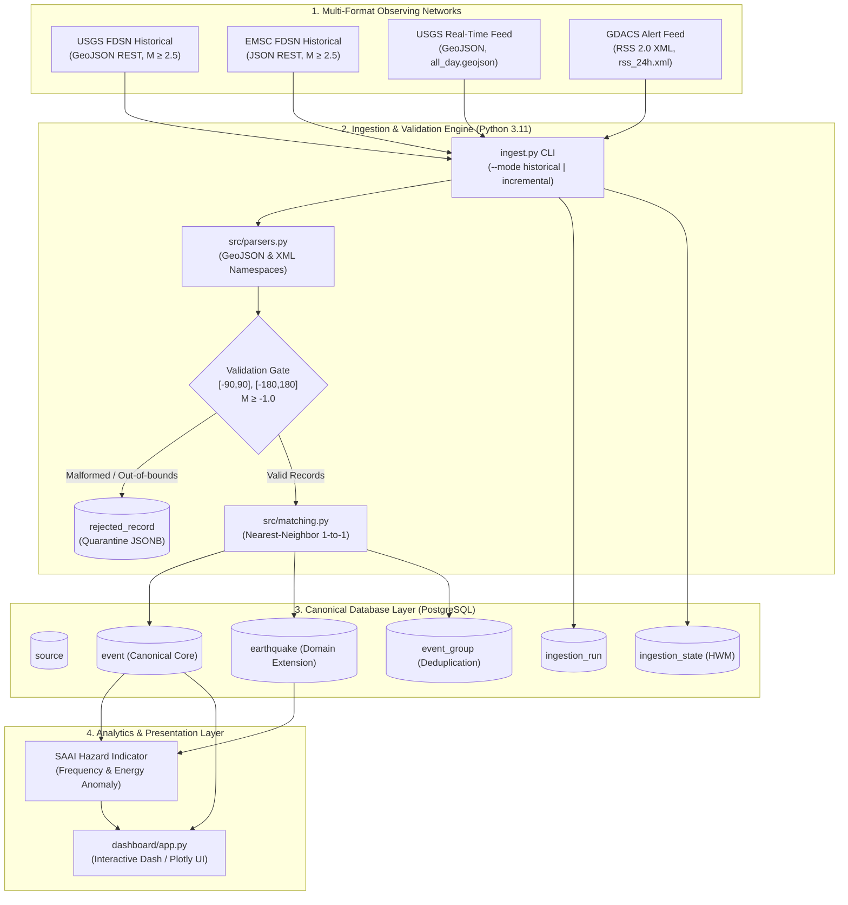

# Natural Hazard Monitoring System — Earthquake Activity Monitoring
**Course:** Programación para Análisis de Datos (Data Analysis Programming) — Semester 2026-II  
**Project:** Natural Hazard Monitoring Systems — **Team 1: Earthquake Activity**  
**Repository:** `earthquake-monitoring-pda-team_1`  
**Team members:**
- Juan Córdoba - 20211020097
- Mauricio Sánchez - 20212020045
- Angelo Ibáñez - 20212020007

[]()
[]()
[]()
[]()

---

## 1. Executive Summary & Project Purpose

Earthquakes are sudden, high-consequence natural hazards caused by tectonic strain energy release along lithospheric faults. Unlike hydrometeorological phenomena, seismic ruptures cannot be predicted deterministically. Monitoring and civil protection depend on **near-instantaneous event detection**, **rapid multi-catalog telemetry reconciliation**, and **quantitative anomaly detection** to direct emergency response and civil defense operations.

This repository implements the end-to-end data engineering architecture for **Team 1**, standardizing and reconciling seismic telemetry from the world's leading seismological networks:
- **USGS (United States Geological Survey):** Global FDSN web services & real-time summary GeoJSON feeds.
- **EMSC (Euro-Mediterranean Seismological Centre):** European & Mediterranean FDSN seismic portal.
- **GDACS (Global Disaster Alert and Coordination System):** Multi-hazard emergency disaster alert feeds.

---

## 2. High-Level System Architecture

The pipeline processes multi-format raw payloads (GeoJSON, JSON, and RSS 2.0 XML), runs schema and bounding validation gates, resolves cross-catalog event duplication via **1-to-1 Nearest-Neighbor Spatio-Temporal Cost Optimization**, and loads into a canonical PostgreSQL store with real-time analytics.



---

## 3. Geophysical Foundations & Domain Understanding

A detailed, peer-reviewed geophysical foundation is documented in [`docs/hazard_definition.md`](docs/hazard_definition.md):
- **Elastic Rebound Theory:** Tectonic strain accumulation, Coulomb frictional failure, and dynamic rupture propagation at shear velocities ($v_r \approx 0.85 v_s$).
- **Wave Propagation Modes:**
  - *Compressional ($P$) waves:* Longitudinal, fastest arrival ($v_p \approx 6 - 8\text{ km/s}$), travels through solids and liquids.
  - *Shear ($S$) waves:* Transverse, high kinetic energy ($v_s \approx 3.5\text{ km/s}$), strictly requires shear rigidity ($\mu > 0$, solids only).
  - *Surface waves (Rayleigh & Love):* Trapped in crustal waveguides, low attenuation ($\propto 1/\sqrt{r}$), dominant cause of high-rise structural resonance.
- **Hypocenter vs. Epicenter:** 3D focal coordinates $(x, y, z)$ vs. 2D surface geoid projection $(x, y, 0)$.
- **Focal Depth Regimes & PGA Attenuation:**
  - *Shallow ($0 - 70\text{ km}$):* High Peak Ground Acceleration (PGA), localized catastrophic destruction, tsunami generation potential.
  - *Intermediate ($70 - 300\text{ km}$):* Wadati-Benioff subduction zones.
  - *Deep ($> 300\text{ km}$):* Severe anelastic attenuation ($e^{-\omega R / 2vQ}$), low surface damage.
- **Magnitude Scale Saturation:** Body-wave ($m_b$) and local ($M_L$) scales saturate at $M \sim 6.0 - 6.5$ due to short-period 1-second filter limits. Moment magnitude ($M_w$) scales directly with physical seismic moment $M_0 = \mu A D$ without saturation.

---

## 4. Validated Source Payloads & Empirical Evidence

All four sources are fully configured in [`config/sources.yaml`](config/sources.yaml) and verified with raw sample payloads meeting the academic $\ge 200$ records requirement:

| Source ID | Institution | Format | Sample Payload File | Verified Records | Scope / Window |
|---|---|:---:|---|:---:|---|
| `usgs_fdsn` | USGS (NEIC) | GeoJSON | [`workshop_1/samples/usgs_historical_raw.json`](workshop_1/samples/usgs_historical_raw.json) | **618** | Global historical ($M \ge 4.5$, 1 month) |
| `emsc_fdsn` | EMSC | JSON | [`workshop_1/samples/emsc_historical_raw.json`](workshop_1/samples/emsc_historical_raw.json) | **627** | Matching global window ($M \ge 4.5$) |
| `usgs_realtime` | USGS | GeoJSON | [`workshop_1/samples/usgs_incremental_raw.json`](workshop_1/samples/usgs_incremental_raw.json) | **1,764** | Real-time rolling 7-day stream (`all_week`) |
| `gdacs_realtime` | GDACS (EU JRC) | RSS 2.0 XML | [`workshop_1/samples/gdacs_incremental_raw.xml`](workshop_1/samples/gdacs_incremental_raw.xml) | **25 (12 EQ)** | Active 24-hour disaster alert feed |

### Empirical Two-Poll Ingestion Characterization
Documented in [`workshop_1/polling_evidence.md`](workshop_1/polling_evidence.md):
- **Poll #1 (`05:33:48Z`):** 12 events captured from `all_hour.geojson`.
- **Poll #2 (`06:52:11Z`):** 10 events captured (**78 min elapsed**, satisfying $\ge 60\text{ min}$ threshold).
- **Window Eviction:** $|P_1 \cap P_2| = 0$, proving sliding-window feeds drop events rapidly without persistent storage.
- **In-Place Revision Proof:** Queried USGS FDSN Web Service to empirically prove that event `aka2026werkhb` received phase-pick refinements (+24.7 min) and event `us7000tx1f` received DYFI/ShakeMap product updates (+62.4 min).
- **Design Decisions:** High-water mark tracks `properties.updated` (not origin time) with a **24-hour overlap window** and idempotent SQL upserts (`ON CONFLICT (event_id) DO UPDATE`).

---

## 5. Source Profiling & Quality Findings Summary

Executed and pre-evaluated in [`notebooks/01_source_profiling.ipynb`](notebooks/01_source_profiling.ipynb):
1. **GDACS XML Parser Defect Resolved:** Targeted `<georss:point>` and extracted magnitude/depth via regex on `<gdacs:severity>`, reducing null rates from 100% to **0.0%**.
2. **Comprehensive Profiling Matrix:** 100% coordinate compliance (all within $[-90, 90]$ and $[-180, 180]$) with zero duplicate IDs.
3. **5 Concrete Quality Issues:** Documented with exact raw snippets for heterogeneous timestamps, uncalibrated/negative depths, magnitude saturation, location naming asymmetry, and artificial 10.0 km pinned depths (affecting 45.1% of global historical events).
4. **Cross-Source Event Matching:**
   - Naive window matching produced 679 candidate matches with **72 1-to-N collisions** during earthquake swarms.
   - Applied **Normalized Spatio-Temporal Nearest-Neighbor Assignment** ($D = \sqrt{(\Delta d / 100\text{km})^2 + (\Delta t / 900\text{s})^2}$), resolving 100% of collisions into **568 clean 1-to-1 pairs** with median $\Delta t = 0.50\text{ s}$ and median $\Delta d = 6.97\text{ km}$.

---

## 6. Canonical Data Schema & Ingestion Contract

Detailed in [`workshop_1/mapping.md`](workshop_1/mapping.md) and implemented in [`sql/schema.sql`](sql/schema.sql):
- **Core Entities:** `source`, `ingestion_run`, `ingestion_state`, `event`, `earthquake`, `event_group`, `rejected_record`.
- **Severity Normalization:** Standardizes magnitude to equivalent moment magnitude $M_w^*$ (Scordilis, 2006) and computes radiated energy:
  $$E = 10^{4.8 + 1.5 M_w^*} \quad (\text{Joules})$$
- **Historical Volume Estimation:** 5-year historical scope yields **$\approx 1,800,000$ events** ($\approx 1.72\text{ GB}$ raw, $\approx 433\text{ MB}$ PostgreSQL storage with indexes).
- **Recursive Temporal Bisection:** Automatically bisects query intervals if aftershock clusters exceed the USGS 20,000-record API limit.

---

## 7. Seismic Activity Anomaly Index (SAAI)

The system proposes the **Seismic Activity Anomaly Index (SAAI)** to quantify real-time departures from background seismicity:

$$\mathbf{SAAI}(t) = 0.4 \cdot \left(\frac{N_{24h}(t) - \mu_N}{\sigma_N}\right) + 0.6 \cdot \left(\frac{\log_{10} E_{24h}(t) - \mu_E}{\sigma_E}\right)$$

- $\text{SAAI} < 1.0$: **NORMAL (Green)** — Baseline seismicity.
- $1.0 \le \text{SAAI} < 2.0$: **ELEVATED (Yellow)** — Minor swarm activity.
- $2.0 \le \text{SAAI} < 3.5$: **HIGH (Orange)** — Significant swarm or moderate rupture.
- $\text{SAAI} \ge 3.5$: **CRITICAL (Red)** — Major megathrust rupture or destructive sequence.

---

## 8. Repository Layout

```text
earthquake-monitoring-pda-team_1/
├── config/
│   └── sources.yaml                # Standardized catalog configuration (4 sources)
├── dashboard/
│   ├── __init__.py
│   └── app.py                      # Interactive Dash / Plotly monitoring application
├── data/
│   └── raw/                        # Git-ignored bulk landing zone (.gitkeep preserved)
├── docs/
│   └── hazard_definition.md        # Comprehensive geophysical domain & project formalization
├── notebooks/
│   └── 01_source_profiling.ipynb   # Executed profiling notebook with pre-evaluated outputs
├── sql/
│   └── schema.sql                  # PostgreSQL production DDL with indexes and constraints
├── src/
│   ├── __init__.py
│   ├── config.py                   # YAML & environment variable loader
│   ├── models.py                   # Canonical dataclass models (Event, Earthquake, Run)
│   ├── parsers.py                  # USGS GeoJSON, EMSC JSON, GDACS XML parsers
│   └── matching.py                 # Haversine & 1-to-1 Nearest-Neighbor matching engine
├── tests/
│   ├── __init__.py
│   ├── test_parsers.py             # Unit tests for multi-format payload parsers
│   ├── test_matching.py            # Unit tests for Haversine & collision resolution
│   └── test_schema.py              # Unit tests validating SQL schema constraints
├── workshop_1/
│   ├── mapping.md                  # Canonical mapping table, Mermaid ERD, and ingestion contract
│   ├── polling_evidence.md         # Empirical two-poll update evidence & diff analysis
│   └── samples/                    # Raw validated JSON/XML samples (≥ 200 records each)
├── .env.example                    # Environment variable template
├── .gitignore                      # Python, data raw, and IDE ignores
├── ingest.py                       # Production Ingestion Worker CLI
└── README.md                       # Master project overview & academic documentation
```

---

## 9. Quickstart & Installation Guide

### Prerequisites
- Python 3.10+
- PostgreSQL 14+ (optional for dry-run CLI execution)

### 1. Clone & Set Up Environment
```bash
git clone https://github.com/AngeloIbanez/earthquake-monitoring-pda-team_1.git
cd earthquake-monitoring-pda-team_1
python3 -m venv .venv
source .venv/bin/activate
pip install pyyaml pandas numpy
```

### 2. Run Test Suite
Execute the built-in unit tests validating parsers, collision-free matching, and schema integrity:
```bash
python3 -m unittest discover tests
```
*Expected Output: `Ran 8 tests in 0.005s. OK.`*

### 3. Run Ingestion CLI
Test the ingestion pipeline in dry-run mode:
```bash
# Historical Mode (USGS & EMSC FDSN samples)
python3 ingest.py --mode historical --dry-run

# Incremental Mode (USGS Real-time & GDACS XML feeds)
python3 ingest.py --mode incremental --dry-run

# Ingest single source
python3 ingest.py --mode incremental --source gdacs_realtime --dry-run
```

### 4. Launch Interactive Dashboard (Optional)
To run the interactive monitoring web application:
```bash
pip install dash plotly
python3 dashboard/app.py
```
Open your browser at `http://localhost:8050`.

---

## 10. Team & Academic Governance
- **Course:** Programación para Análisis de Datos (PDA) — 2026-II
- **Team 1:** Natural Hazard Monitoring Systems — Earthquake Activity Monitoring
- **Deliverable:** Workshop #1 — Hazard Definition, Source Validation, and Data Contract
