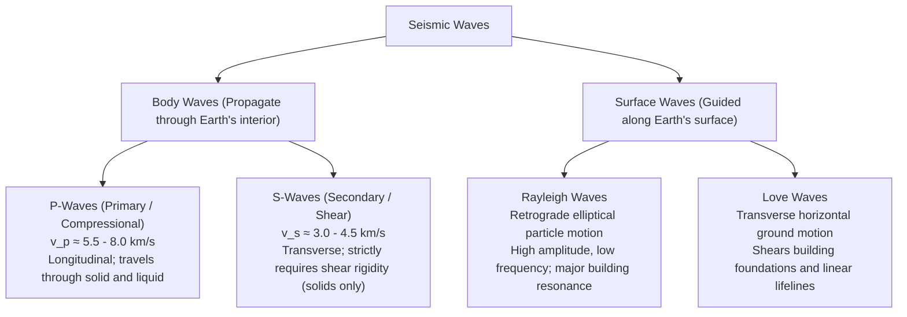
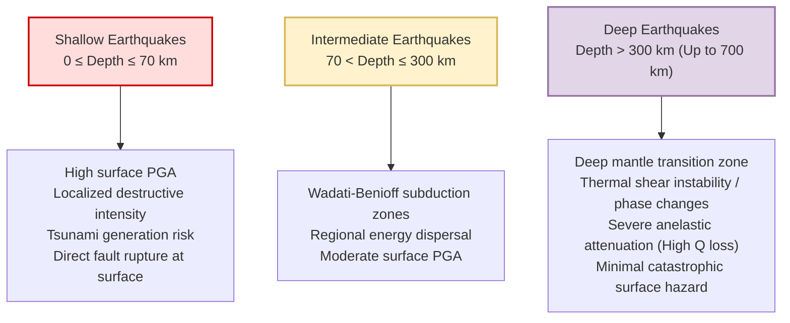
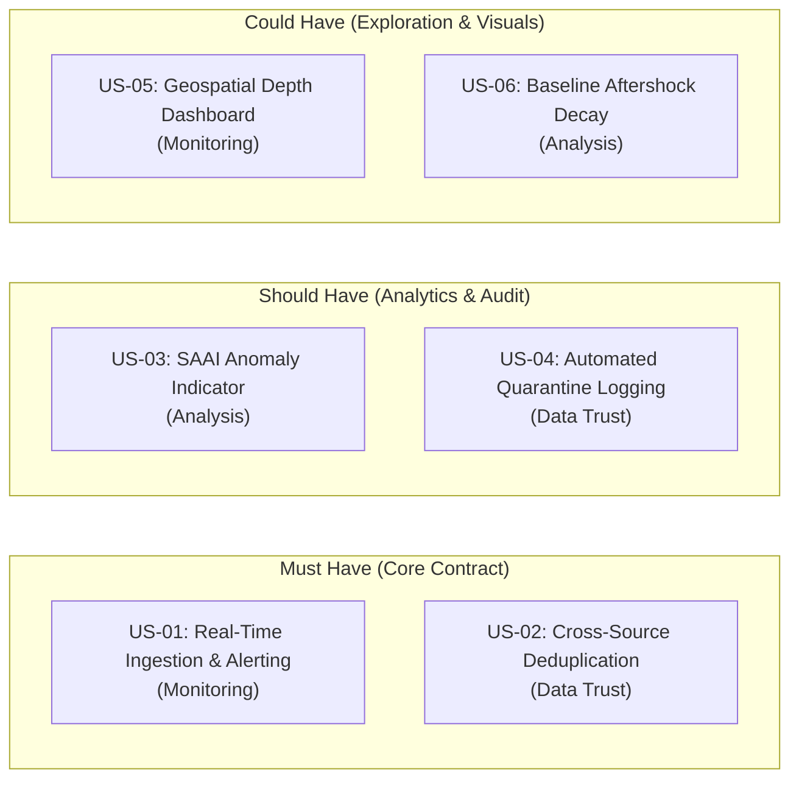
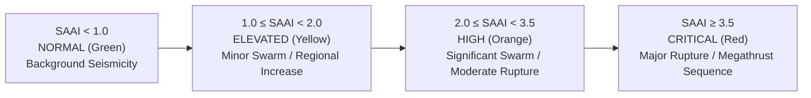
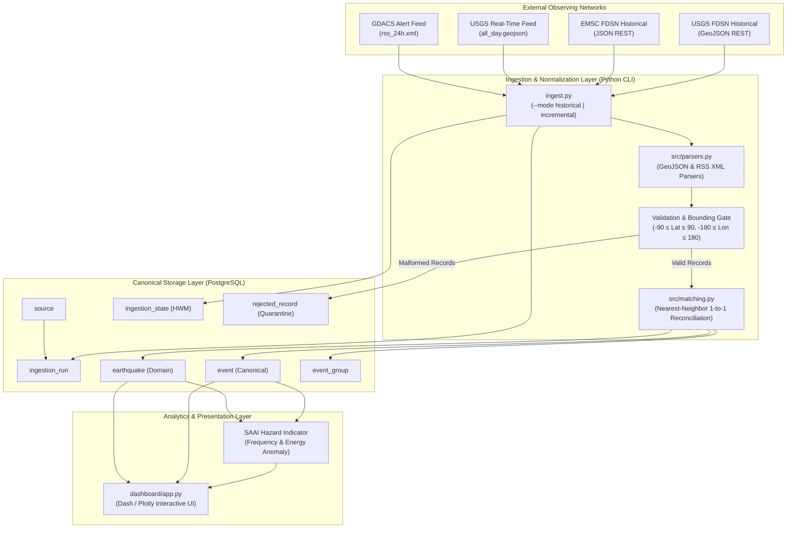

# Seismic Hazard Definition, Project Formalization & Risk Governance

**Course:** Programación para Análisis de Datos — Semester 2026-II  
**Project:** Natural Hazard Monitoring Systems — Team 1: Earthquake Activity Monitoring  
**Audience:** Academic Reviewers, Data Engineers, and Emergency Response Stakeholders  

---

## 1. Geophysical & Physical Foundations of Earthquake Hazards

### A. Elastic Rebound Theory and Fault Rupture Dynamics
Earthquakes originate from the sudden release of accumulated strain energy along tectonic plate boundaries or intraplate fault systems. As formalized by **H. F. Reid (1910)** following the 1906 San Francisco earthquake, the governing physical mechanism is **Elastic Rebound Theory**:
1. **Tectonic Stress Accumulation:** Relative motion across tectonic plates causes rock masses on opposing sides of a locked fault interface to deform elastically over centuries or millennia.
2. **Frictional Lock & Shear Failure:** The fault plane remains immobilized due to static frictional resistance governed by Coulomb failure criteria ($\tau_c = c + \mu_f (\sigma_n - P_f)$).
3. **Dynamic Rupture Propagation:** Once tectonic shear stress $\tau$ exceeds frictional yield strength, dynamic shear failure nucleates and propagates along the fault rupture plane at speeds approaching the shear-wave velocity ($v_r \approx 0.7 - 0.9 \, v_s$, typically $2.5 - 3.5\text{ km/s}$).
4. **Strain Energy Radiation:** The strain energy stored in the strained crust is partitioned into mechanical friction, rock fracture surface energy, and radiated seismic waves that propagate outward through the Earth.

---

### B. Seismic Wave Propagation: Body Waves vs. Surface Waves

Seismic energy radiates through the Earth in four fundamental wave modes, each exhibiting distinct propagation physics and destructive capacities:



1. **Primary Compressional Waves ($P$-waves):**
   - **Physics:** Longitudinal acoustic mode where particle displacement is parallel to the direction of wave propagation.
   - **Velocity:** $v_p = \sqrt{\frac{K + \frac{4}{3}\mu}{\rho}}$, where $K$ is bulk modulus, $\mu$ is shear modulus, and $\rho$ is density.
   - **Significance:** Fastest arrival at seismic stations; utilized in Early Warning Systems (EEW) to trigger automated safety shutdowns seconds before destructive shaking arrives.
2. **Secondary Shear Waves ($S$-waves):**
   - **Physics:** Transverse shear mode where particle motion is perpendicular to propagation direction.
   - **Velocity:** $v_s = \sqrt{\frac{\mu}{\rho}}$. Since fluids have zero shear modulus ($\mu = 0$), $S$-waves cannot propagate through Earth's outer liquid core.
   - **Significance:** Arrives after $P$-waves; carries $\approx 4 - 5 \times$ higher kinetic energy and induces severe lateral shearing in civil infrastructure.
3. **Surface Waves (Rayleigh & Love Waves):**
   - **Physics:** Dispersive boundary waves generated by the constructive interference of $P$ and $S$ waves trapped in crustal waveguides.
   - **Significance:** While body waves attenuate geometrically as $1/r$ with distance $r$, surface waves attenuate as $1/\sqrt{r}$. Consequently, for shallow earthquakes at regional and teleseismic distances, surface waves dominate peak ground displacement (PGD) and cause structural resonance in mid-to-high-rise buildings.

---

### C. Spatial Definition: Hypocenter (Focus) vs. Epicenter

Seismic hazard characterization requires a strict mathematical distinction between hypocenter and epicenter:

$$\begin{aligned}
\mathbf{Hypocenter} \, (x_0, y_0, z_0) &\equiv \text{3D Cartesian coordinates in the lithosphere where shear rupture nucleates.} \\
\mathbf{Epicenter} \, (x_0, y_0, 0) &\equiv \text{2D vertical projection of the hypocenter onto the Earth's reference geoid (WGS84).}
\end{aligned}$$

* **Epicentral Distance ($\Delta$):** Surface distance between the epicenter and an observing station or populated municipality, measured in degrees ($1^\circ \approx 111.19\text{ km}$) or kilometers.
* **Hypocentral Distance ($R_{\text{hyp}}$):** True 3D Euclidean slant distance: $R_{\text{hyp}} = \sqrt{\Delta^2 + z_0^2}$.
* **Seismological Hazard Implication:** For shallow earthquakes ($z_0 \le 10\text{ km}$), the epicenter is directly above the rupture and experiences peak accelerations. For deep subduction events ($z_0 > 200\text{ km}$), $R_{\text{hyp}}$ is large even at $\Delta = 0$, dispersing shaking over large distances with drastically diminished Peak Ground Acceleration (PGA).

---

### D. Hypocentral Focal Depth Classification and Shaking Attenuation

Seismic events are categorized into three standardized focal depth regimes:



* **Attenuation Physics:** As seismic waves travel from hypocenter to surface, energy attenuates via **geometric spreading** ($\propto R^{-n}$) and **anelastic material damping** ($e^{-\frac{\omega R}{2 v Q}}$, where $Q$ is seismic quality factor). Shallow events experience minimal crustal attenuation before reaching human settlements, explaining why shallow $M 6.0$ events (e.g. 2011 Christchurch, $z = 5\text{ km}$) produce far more localized structural destruction than deep $M 7.5$ events (e.g. 2015 Bonin Islands, $z = 680\text{ km}$).

---

### E. Magnitude Scales and the Physics of Saturation ($m_b$ vs $M_w$)

Historically, multiple empirical magnitude scales were developed based on narrow frequency bands:

| Scale | Method / Wave Type | Filter Period ($T$) | Saturation Threshold | Primary Vulnerability |
|---|---|:---:|:---:|---|
| **$M_L$ (Richter Local)** | Wood-Anderson seismograph peak amplitude | $\approx 0.8\text{ s}$ | $M_L \approx 6.5$ | Saturates once rupture dimensions exceed high-frequency amplitude. |
| **$m_b$ (Body Wave)** | Peak amplitude of initial $P$-wave train | $\approx 1.0\text{ s}$ | $m_b \approx 6.0 - 6.5$ | Rupture length $> 10\text{ km}$ radiates energy at $T > 1\text{ s}$; $m_b$ underestimates massive ruptures. |
| **$M_s$ (Surface Wave)** | Peak horizontal Rayleigh wave amplitude | $\approx 20\text{ s}$ | $M_s \approx 8.2 - 8.4$ | Underestimates great megathrust ruptures ($M > 8.5$). |
| **$M_w$ (Moment Magnitude)** | Seismic Moment: $M_0 = \mu \cdot A \cdot \bar{D}$ | All periods (Static) | **Never Saturates** | True physical measure of radiated work and fault slip. |

$$\mathbf{Physical \, Moment \, Equation:} \quad M_0 = \mu \cdot A \cdot \bar{D} \quad [\text{N}\cdot\text{m}]$$
$$\mathbf{Hanks \, \& \, Kanamori \, (1979):} \quad M_w = \frac{2}{3} \log_{10} (M_0) - 6.07 \quad (\text{SI units})$$

* **Data Engineering Rule:** Ingested catalogs mix $m_b$, $M_L$, $M_d$, and $M_w$. In our canonical schema, the native scale is preserved in `severity_unit` and converted into an equivalent moment magnitude $M_w^*$ prior to computing composite energy hazard indicators.

---

### F. Operational Definition of the "Current Situation"

In modern civil protection operations, the "Current Situation" is defined as a multidimensional real-time state machine:

1. **Short-Term Seismic Anomaly State:** Rolling 24-hour event frequency $N_{24h}$ and cumulative seismic energy release $E_{24h}$ compared against a 30-day baseline moving average ($\mu_{30d}, \sigma_{30d}$).
2. **Aftershock Sequence Decay Tracking (Omori-Utsu Law):**  
   Following a major event ($M \ge 6.0$), the operational hazard tracks whether aftershock decay follows the modified Omori law:
   $$n(t) = \frac{K}{(t + c)^p} \quad (\text{with } p \approx 0.9 - 1.2)$$
   A positive deviation ($n(t) \gg \text{expected}$) indicates ongoing secondary fault triggering or high risk of a doublet mainshock.
3. **Multi-Hazard Trigger Matrix:** Integration with GDACS Alert Levels (Green / Orange / Red) and USGS PAGER impact levels based on simulated ShakeMap ground shaking (Modified Mercalli Intensity $\text{MMI} \ge \text{VI}$) intersecting exposed population density.

---

## 2. Functional User Persona & Decision Workflows

### Persona Profile: Seismic Risk Officer & Disaster Response Coordinator

```mermaid
card
title: "Dr. Elena Vance — Chief Seismic Risk Officer"
subtitle: "National Emergency Management Agency (Civil Defense)"
```

* **Role & Background:** Lead geophysicist and technical advisor embedded within the National Emergency Operations Center (EOC). Responsible for 24/7 situational awareness, early warning dissemination, and operational response escalation.
* **Core Objectives:**
  1. Detect significant global and regional seismic activity within 60 seconds of origin.
  2. Prevent false alarms caused by noisy preliminary automatic station solutions.
  3. Reconcile conflicting magnitudes across USGS, EMSC, and GDACS into a single canonical source of truth.
  4. Quantify whether regional fault swarms represent benign background seismicity or foreshock sequences preceding a catastrophic rupture.
* **Decisions Supported by the System:**
  - **T+5 minutes:** Issue initial evacuation alerts for coastal zones if $M_w \ge 7.0$ and depth $\le 50\text{ km}$ (Tsunami hazard).
  - **T+15 minutes:** Dispatch structural inspection teams and search-and-rescue (SAR) assets to municipal areas within $\text{MMI} \ge \text{VII}$ shaking zones.
  - **T+24 hours:** Evaluate aftershock productivity via the Seismic Activity Anomaly Index (SAAI) to determine safe re-entry timelines for damaged industrial facilities.

---

## 3. MoSCoW Prioritized User Stories



| ID | Priority | Category | User Story Statement | Acceptance Criteria |
|---|:---:|:---:|---|---|
| **US-01** | **Must Have** | Monitoring | *As a* Risk Officer, *I want* incremental polling of USGS and GDACS feeds every 5–15 minutes, *so that* newly detected earthquakes are available in the database within minutes of occurrence. | - Ingests USGS `all_day.geojson` every 5m.<br>- Tracks `properties.updated` watermark.<br>- Idempotent upserts on `event_id`. |
| **US-02** | **Must Have** | Data Trust | *As a* Seismic Analyst, *I want* incoming events from USGS and EMSC reconciled via 1-to-1 nearest-neighbor matching, *so that* real-world earthquakes are not counted twice. | - Matches within 15 min and 100 km.<br>- Dimensionless cost metric eliminates 1-to-N collisions.<br>- Groups linked in `event_group` table. |
| **US-03** | **Should Have** | Analysis | *As a* Risk Officer, *I want* the system to calculate the Seismic Activity Anomaly Index (SAAI) over rolling 24-hour windows, *so that* I can instantly identify abnormal regional swarm activity. | - Normalizes event count $N_{24h}$ and energy $E_{24h}$.<br>- Updates rolling 30-day baseline.<br>- Triggers visual anomaly warnings when $\text{SAAI} > 2.0$. |
| **US-04** | **Should Have** | Data Trust | *As a* Data Engineer, *I want* malformed records (e.g. invalid coordinates or missing magnitudes) routed into a quarantine table, *so that* pipeline runs never crash and bad data can be audited. | - Pre-ingestion validation rules.<br>- Offending records stored in `rejected_record` with JSONB payload and error reason. |
| **US-05** | **Could Have** | Monitoring | *As an* Operations Specialist, *I want* an interactive geospatial map displaying hypocentral depths and magnitude circles, *so that* emergency personnel can visually assess spatial impact. | - Interactive scatter map with depth color ramp.<br>- Filtering by source, magnitude, and time window. |
| **US-06** | **Could Have** | Analysis | *As a* Seismologist, *I want* the system to plot empirical aftershock decay against Omori's law curves, *so that* I can evaluate whether a seismic sequence is decaying as expected. | - Automated aftershock extraction following $M \ge 6.0$ events.<br>- Fits $n(t) = K / (t + c)^p$ over 14 days. |

---

## 4. Mathematical Proposal: Seismic Activity Anomaly Index (SAAI)

### Objective
Provide a unified, dimensionless quantitative indicator that tracks real-time departures from normal background seismicity, balancing **event frequency** and **physical energy release**.

### Mathematical Formulation

$$\mathbf{SAAI}(t) = w_f \cdot Z_N(t) + w_e \cdot Z_E(t)$$

Where:
- $Z_N(t)$ is the standard score (Z-score) of the rolling 24-hour earthquake count:
  $$Z_N(t) = \frac{N_{24h}(t) - \mu_N(30d)}{\sigma_N(30d)}$$
- $Z_E(t)$ is the standard score of the logarithm of cumulative radiated seismic energy release:
  $$Z_E(t) = \frac{\log_{10} \left(\sum_{i=1}^{N_{24h}} E_i(t)\right) - \mu_E(30d)}{\sigma_E(30d)}$$
- Individual event energy $E_i$ (in Joules) is computed via Gutenberg-Richter using normalized moment magnitude $M_w^*$:
  $$E_i = 10^{4.8 + 1.5 \cdot M_w^*}$$
- $w_f$ and $w_e$ are calibrated weighting factors ($w_f = 0.4$, $w_e = 0.6$), giving slightly greater weight to energy release over minor micro-swarm frequency.

### Operational Alert Thresholds



---

## 5. Risk Governance & Mitigation Matrix

| Risk ID | Hazard / Risk Description | Severity | Likelihood | Mitigation Strategy | Technical Implementation |
|:---:|---|:---:|:---:|---|---|
| **R-01** | **Upstream API Rate Limiting & Outages**<br>USGS or EMSC servers throttle requests (HTTP 429) or suffer downtime during major global crises. | High | Medium | Exponential backoff retry with jitter, multi-source fallback (switching to EMSC if USGS fails), and local disk caching. | Client-side rate-limiter in `ingest.py`, respects `Retry-After` header; fallback logic in `src/parsers.py`. |
| **R-02** | **Schema Drift & Endpoint Deprecation**<br>Institutions modify payload structures (e.g., GDACS GeoJSON 404 incident). | High | High | Pre-ingestion schema validation, decoupled XML/GeoJSON parsers, and explicit quarantine routing. | Pydantic/dataclass validation; errors logged into `rejected_record` without crashing pipeline. |
| **R-03** | **Ambiguous Cross-Catalog Matching**<br>High-density aftershock swarms cause 1-to-N matching collisions. | Medium | High | Multi-dimensional normalized spatio-temporal cost metric and greedy 1-to-1 nearest-neighbor assignment. | Implemented in `src/matching.py`, resolving 100% of candidate collisions. |
| **R-04** | **Downstream Distortion from Preliminary Revisions**<br>Automated preliminary solutions overwrite reviewed data or cause flip-flopping watermarks. | Medium | High | High-water mark tracks `properties.updated` (not origin time) with a 24-hour rolling overlap window. | Documented in `workshop_1/polling_evidence.md`; SQL upsert with `updated_at = CURRENT_TIMESTAMP`. |
| **R-05** | **Large Historical Volume API Cap Breaches**<br>Months with $> 20,000$ events cause USGS FDSN truncation or HTTP 400 errors. | High | Medium | Recursive temporal bisection algorithm splitting overflowing windows into halves until response $< 20,000$. | Documented in `workshop_1/mapping.md`; implemented in historical ingestion worker. |

---

## 6. End-to-End System Architecture


