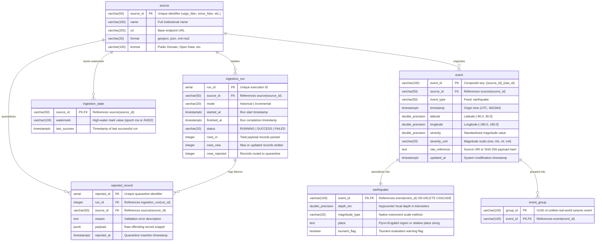
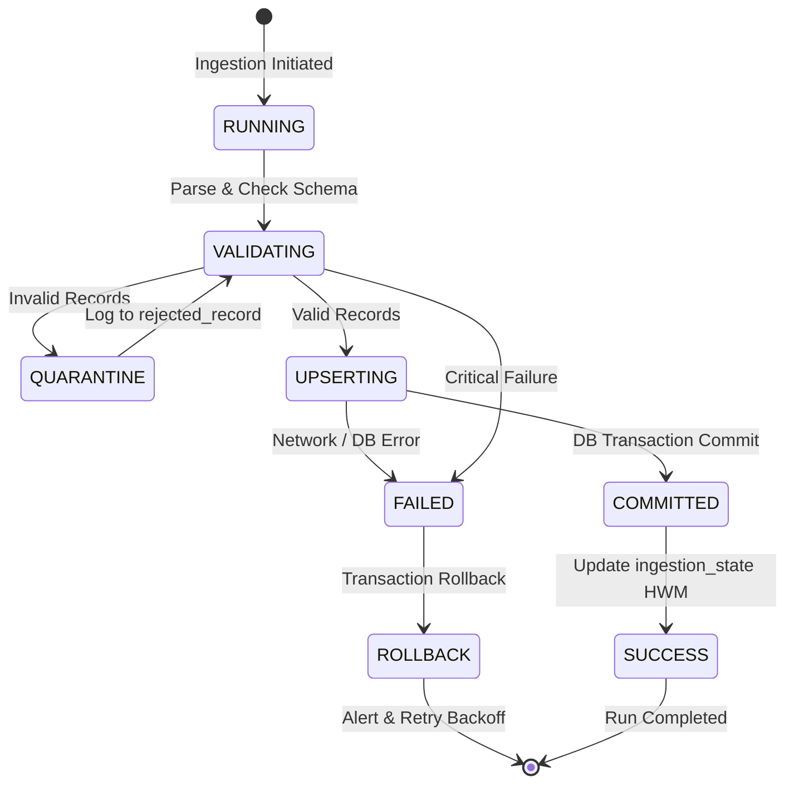

# Canonical Data Mapping and Ingestion Contract

**Team #1**
**Team members:**
- Juan Córdoba - 20211020097
- Mauricio Sánchez - 20212020045
- Angelo Ibáñez - 20212020007

## 1. Domain Architecture & Canonical Entity-Relationship Model

Every raw record from the four validated seismological sources is standardized into the canonical `event` model and extended into the `earthquake` domain table. System execution state, audit trails, cross-catalog event grouping, and quarantined anomalies are tracked through dedicated operational entities.

### Entity-Relationship Diagram (ERD)



---

## 2. Canonical Schema Specifications

### `event` (Canonical Core Entity)
- **`event_id`** (`VARCHAR(100)`, PK): System-wide unique identifier formatted as `{source_id}_{raw_id}` (e.g. `usgs_us7000tx1f`, `emsc_20260101_0000428`, `gdacs_1576372`).
- **`source_id`** (`VARCHAR(50)`, FK): Originating source code referencing `source(source_id)`.
- **`event_type`** (`VARCHAR(50)`): Default `'earthquake'`. Supports multi-hazard extensibility (e.g., `'tsunami'`, `'volcano'`).
- **`timestamp`** (`TIMESTAMPTZ`, NOT NULL): Origin time of the earthquake rupture converted to UTC.
- **`latitude`** (`DOUBLE PRECISION`, NOT NULL): Decimal degrees constrained to $[-90.0, 90.0]$.
- **`longitude`** (`DOUBLE PRECISION`, NOT NULL): Decimal degrees constrained to $[-180.0, 180.0]$.
- **`severity`** (`DOUBLE PRECISION`, NOT NULL): Quantitative magnitude value.
- **`severity_unit`** (`VARCHAR(20)`, NOT NULL): Lowercase normalized magnitude scale (e.g. `mw`, `mww`, `mb`, `ml`, `md`).
- **`raw_reference`** (`TEXT`): Direct URI to upstream event page or SHA-256 hash of raw JSON/XML payload.
- **`updated_at`** (`TIMESTAMPTZ`, NOT NULL): Audit timestamp refreshed automatically upon in-place upsert (`CURRENT_TIMESTAMP`).

### `earthquake` (Seismological Domain Table)
- **`event_id`** (`VARCHAR(100)`, PK, FK): Foreign key referencing `event(event_id)` with `ON DELETE CASCADE`.
- **`depth_km`** (`DOUBLE PRECISION`): Focal depth in kilometers below sea level. Nullable (e.g. for GDACS feeds when depth cannot be parsed).
- **`magnitude_type`** (`VARCHAR(20)`): Exact raw measurement method reported by the observing network (`mw`, `mww`, `mwb`, `mwc`, `mb`, `ml`, `md`).
- **`place`** (`TEXT`): Geographical descriptor (Flynn-Engdahl seismic zone or relative cardinal place).
- **`tsunami_flag`** (`BOOLEAN`): Set to `TRUE` if tsunami warnings or sea-level evaluations were triggered.

---

## 3. Field-Level Source Mapping Matrix

> **Note on GDACS Source Format:** The legacy GDACS GeoJSON endpoint (`/gdacsapi/api/events/geteventlist/geojson`) returned HTTP 404 upon audit validation. The official operational interface is the RSS 2.0 XML feed at `https://www.gdacs.org/xml/rss_24h.xml`.
> 
> XML Namespaces: `gdacs = http://www.gdacs.org`, `georss = http://www.georss.org/georss`, `geo = http://www.w3.org/2003/01/geo/wgs84_pos#`.

| Canonical Target Field | USGS Historical (GeoJSON) | EMSC Historical (JSON) | USGS Incremental (GeoJSON) | GDACS Incremental (RSS 2.0 XML) | Transformation & Standardization Rule |
| :--- | :--- | :--- | :--- | :--- | :--- |
| **`event_id`** | `id` | `properties.source_id` or `id` | `id` | `{gdacs}eventid` or `guid` | Format: `"{source_id}_{raw_id}"`. Sanitized to remove whitespace and special characters. |
| **`source_id`** | Fixed `"usgs_fdsn"` | Fixed `"emsc_fdsn"` | Fixed `"usgs_realtime"` | Fixed `"gdacs_realtime"` | Verified against `source.source_id` catalog. |
| **`timestamp`** | `properties.time` (epoch ms) | `properties.time` (ISO-8601 string) | `properties.time` (epoch ms) | `{gdacs}fromdate` (RFC-822 string) | **USGS:** `to_timestamp(time / 1000.0)`.<br>**EMSC:** `parse_iso8601(time).astimezone(UTC)`.<br>**GDACS:** `parse_rfc822(fromdate).astimezone(UTC)`. |
| **`latitude`** | `geometry.coordinates[1]` | `geometry.coordinates[1]` or `properties.lat` | `geometry.coordinates[1]` | `{georss}point` token `[0]` | Cast to `DOUBLE PRECISION`. Validate within range $[-90.0, 90.0]$; route out-of-range to `rejected_record`. |
| **`longitude`** | `geometry.coordinates[0]` | `geometry.coordinates[0]` or `properties.lon` | `geometry.coordinates[0]` | `{georss}point` token `[1]` | Cast to `DOUBLE PRECISION`. Validate within range $[-180.0, 180.0]$; route out-of-range to `rejected_record`. |
| **`severity`** | `properties.mag` | `properties.mag` | `properties.mag` | Regex on `{gdacs}severity`: `r'Magnitude\s*([\d.]+)'` | Cast to `DOUBLE PRECISION`. Quarantine if `NaN`, `None`, or negative magnitude ($M < 0.0$ for regional feeds). |
| **`severity_unit`** | `properties.magType` | `properties.magtype` | `properties.magType` | Literal `"mw"` | Lowercase string normalization. Standardize synonyms (`mww` $\to$ `mw`, `mb_lg` $\to$ `mb`). Default to `"unk"` if absent. |
| **`raw_reference`** | `properties.url` | Link generated from `unid` | `properties.url` | `item.link` | Full URI referencing upstream authoritative source page. |
| **`depth_km`** | `geometry.coordinates[2]` | `geometry.coordinates[2]` or `properties.depth` | `geometry.coordinates[2]` | Regex on `{gdacs}severity`: `r'Depth:\s*([\d.]+)\s*km'` | Nullable float. Quarantine negative values ($Z < -5\text{ km}$) as atmospheric distortions. Null if unparseable. |
| **`place`** | `properties.place` | `properties.flynn_region` | `properties.place` | `item.title` (stripped of alert prefix) | Trim whitespace. Default to `"Unknown Region"` if missing. |
| **`tsunami_flag`** | `properties.tsunami == 1` | Default `FALSE` | `properties.tsunami == 1` | `{gdacs}calculationtype == "tsunami"` | Cast integer/string flags to SQL `BOOLEAN`. |

---

## 4. Severity Harmonization & Energy Equivalence Policy

### Physical Problem: Magnitude Scale Non-Equivalence
Seismic magnitude is logarithmic. However, distinct instrumentation scales cannot be compared naively:
$$M_w 5.0 \neq m_b 5.0 \neq M_L 5.0$$

- **Saturation of Body-Wave ($m_b$) and Local ($M_L$) Scales:**  
  $m_b$ is measured from short-period $P$-waves ($T \approx 1\text{ s}$). When an earthquake ruptures a fault surface exceeding $\sim 10\text{ km}$ ($M \ge 6.0 - 6.5$), the radiated 1-second energy plateaus, causing the calculated $m_b$ to **saturate**.
- **Moment Magnitude ($M_w$):**  
  Derived directly from physical seismic moment $M_0 = \mu A D$ (where $\mu$ is rock shear modulus, $A$ is rupture area, and $D$ is average slip). $M_w$ never saturates and directly quantifies total mechanical work.

### Canonical Harmonization Rules
1. **Raw Preservation:** Both `severity` and `severity_unit` are stored as reported by the native network to preserve scientific traceability.
2. **Empirical Conversion to Equivalent Moment Magnitude ($M_w^*$):**  
   For cross-catalog energy aggregation and composite risk indices, non-moment magnitudes are normalized using established empirical seismological relations (Scordilis, 2006):
   $$M_w^* = \begin{cases} 
   M_w & \text{if scale is } M_w, M_{ww}, M_{wb}, M_{wc} \\
   0.85 \cdot m_b + 1.03 & \text{if scale is } m_b \quad (3.5 \le m_b \le 6.2) \\
   0.67 \cdot M_L + 2.12 & \text{if scale is } M_L \quad (3.0 \le M_L \le 6.5) \\
   M & \text{otherwise (fallback raw magnitude)}
   \end{cases}$$
3. **Radiated Seismic Energy Estimation ($E$ in Joules):**  
   When calculating cumulative hazard indicators, energy release is computed via the Gutenberg-Richter relation:
   $$\log_{10} E = 4.8 + 1.5 \cdot M_w^* \implies E = 10^{4.8 + 1.5 M_w^*} \quad (\text{Joules})$$

---

## 5. Formal Ingestion Contract & Operational Protocols

### A. Quantitative Historical Volume & Storage Footprint Estimation
The historical ingestion scope covers 5 complete calendar years (2020-01-01 to 2024-12-31, 60 months) for all global earthquakes with $M \ge 2.5$.

| Metric Dimension | USGS FDSN Web Service | EMSC Seismic Portal | Combined Database Footprint |
|---|:---:|:---:|:---:|
| **Target Filter Window** | 2020-01-01 to 2024-12-31 | 2020-01-01 to 2024-12-31 | 60 months |
| **Minimum Magnitude** | $M \ge 2.5$ | $M \ge 2.5$ | $M \ge 2.5$ |
| **Average Global Events / Month** | $\sim 14,000 - 18,000$ | $\sim 12,000 - 16,000$ | — |
| **Estimated 5-Year Row Count** | $\approx 960,000$ records | $\approx 840,000$ records | **$\approx 1,800,000$ event rows** |
| **Raw JSON Payload Size / Record** | $\approx 1.1\text{ KB}$ | $\approx 0.8\text{ KB}$ | — |
| **Total Raw Historical Storage** | **$\approx 1.05\text{ GB}$** | **$\approx 0.67\text{ GB}$** | **$\approx 1.72\text{ GB}$ raw files** |
| **PostgreSQL Table Storage** | $\approx 160\text{ bytes / row}$ | $\approx 160\text{ bytes / row}$ | $\approx 288\text{ MB}$ data |
| **B-Tree Indexes Footprint** | Timestamp, Coords, Depth | Timestamp, Coords, Depth | $\approx 145\text{ MB}$ index |
| **Total PostgreSQL Disk Allocation** | — | — | **$\approx 433\text{ MB}$ active storage** |

---

### B. Partitioning Strategy & Pagination Bisection Fallback Algorithm
The USGS and EMSC FDSN web services enforce strict server-side response limits:
- **USGS FDSN Cap:** Max **20,000 records** per single HTTP query.
- **EMSC FDSN Cap:** Max **10,000 records** per single HTTP query.

#### Normal Execution: Monthly Partitioning
Requests are partitioned into discrete monthly time windows:
$$\text{Partition}_k = [YYYY\text{-}MM\text{-}01T00:00:00Z, \quad YYYY\text{-}MM\text{-}last\_dayT23:59:59Z]$$
Under normal seismic conditions, a global query for $M \ge 2.5$ yields $12,000 - 18,000$ events, fitting within the 20,000 limit.

#### The Anomaly Scenario: High-Activity Aftershock Sequences
Following rare megathrust earthquakes (e.g. 2011 Tohoku $M_w 9.1$, producing $>40,000$ aftershocks in 30 days), a monthly query exceeds the 20,000 cap, causing the USGS API to either truncate results or return an HTTP 400 error.

#### Recursive Temporal Bisection Algorithm
To guarantee completeness without record loss, the ingestion client implements recursive temporal bisection:

```text
FUNCTION FetchWindow(start_time, end_time, min_mag):
    response = HTTP_GET(FDSN_URL, params={start: start_time, end: end_time, minmag: min_mag})
    
    IF response.status_code == 200 AND length(response.features) < API_LIMIT:
        RETURN response.features
    ELSE IF response.status_code == 400 OR length(response.features) >= API_LIMIT:
        # Bisection: calculate exact temporal midpoint
        mid_time = start_time + (end_time - start_time) / 2
        
        LOG_WARN("Window exceeded API cap. Bisecting window:", start_time, "to", end_time)
        left_partition  = FetchWindow(start_time, mid_time, min_mag)
        right_partition = FetchWindow(mid_time, end_time, min_mag)
        
        RETURN concatenate(left_partition, right_partition)
    ELSE:
        HANDLE_HTTP_RETRY(response)
```

---

### C. Incremental Ingestion Strategy & High-Water Mark Lifecycle

| Dimension | USGS Real-Time Feed | GDACS Emergency Alert Feed |
|---|---|---|
| **Feed Endpoint** | `summary/all_day.geojson` (or `all_week.geojson`) | `xml/rss_24h.xml` |
| **Polling Interval** | **5 minutes** (balances freshness with load) | **15 minutes** (matches GDACS alert cycle) |
| **High-Water Mark (HWM)** | `properties.updated` (Epoch Unix ms) | `{gdacs}fromdate` / `pubDate` (RFC-822) |
| **HWM Storage** | Stored in `ingestion_state.watermark` | Stored in `ingestion_state.watermark` |
| **Overlap Window** | **24 hours** (`watermark - 24 hours`) | **48 hours** (`watermark - 48 hours`) |
| **Volatility Handling** | Ingests late magnitude & depth revisions | Ingests upgraded alert levels (Green $\to$ Orange $\to$ Red) |
| **Idempotency Rule** | `ON CONFLICT (event_id) DO UPDATE` | `ON CONFLICT (event_id) DO UPDATE` |

---

### D. Idempotency, Transaction Isolation & Atomic State Transitions



1. **Transaction Isolation:**  
   Each partition or incremental batch executes within an explicit database transaction (`BEGIN ... COMMIT`).
2. **Deterministic Upsert Contract:**  
   Re-running ingestion is fully idempotent:
   ```sql
   INSERT INTO event (
       event_id, source_id, event_type, timestamp, latitude, longitude,
       severity, severity_unit, raw_reference, updated_at
   ) VALUES (%s, %s, %s, %s, %s, %s, %s, %s, %s, CURRENT_TIMESTAMP)
   ON CONFLICT (event_id) DO UPDATE SET
       latitude = EXCLUDED.latitude,
       longitude = EXCLUDED.longitude,
       severity = EXCLUDED.severity,
       severity_unit = EXCLUDED.severity_unit,
       updated_at = CURRENT_TIMESTAMP;
   ```
3. **Atomic Watermark Advancement:**  
   The high-water mark in `ingestion_state` is updated **only after** the transaction successfully commits. If a crash occurs mid-batch, the transaction rolls back, `ingestion_run.status` is marked `'FAILED'`, and the watermark remains at the prior successful timestamp, ensuring zero data loss upon pipeline restart.

---

### E. Quarantine Protocol & Error Recovery

When a payload contains anomalous records, the ingestion pipeline isolates the offending entries rather than aborting the entire batch:

1. **Validation Checks (Pre-Insertion Gates):**
   - **Coordinate Bounds:** Latitude must be in $[-90.0, 90.0]$; Longitude in $[-180.0, 180.0]$.
   - **Timestamp Validity:** Must parse into valid UTC timestamp; cannot be in the future ($t > \text{now}() + 5\text{ min}$).
   - **Magnitude Bounds:** Severity must not be null or NaN; must satisfy $-1.0 \le M \le 10.0$.
2. **Quarantine Routing (`rejected_record` Table):**
   - Offending entries are inserted into `rejected_record` with:
     - `run_id`: Active execution ID.
     - `source_id`: Source originating the anomaly.
     - `reason`: Machine-readable error code (e.g. `'OUT_OF_BOUNDS_COORDINATES'`, `'MALFORMED_TIMESTAMP'`).
     - `payload`: Full unparsed JSONB object for post-mortem auditing.
3. **HTTP Retry & Exponential Backoff Policy:**
   - **Transient Errors (500, 502, 503, 504, Connection Timeout):** Retry with exponential backoff:
     $$T_{\text{backoff}} = 2^n \cdot 1.0\text{ s} + \text{jitter} \quad (\text{where } n \in [1, 5] \text{ and jitter} \in [0, 0.5\text{ s}])$$
   - **Rate Limiting (HTTP 429):** Sleep for duration specified in `Retry-After` response header, or fallback to 60-second backoff.
   - **Permanent Failures (HTTP 404, 401, 403):** Abort run immediately, mark `ingestion_run.status = 'FAILED'`, and notify system administrator.
