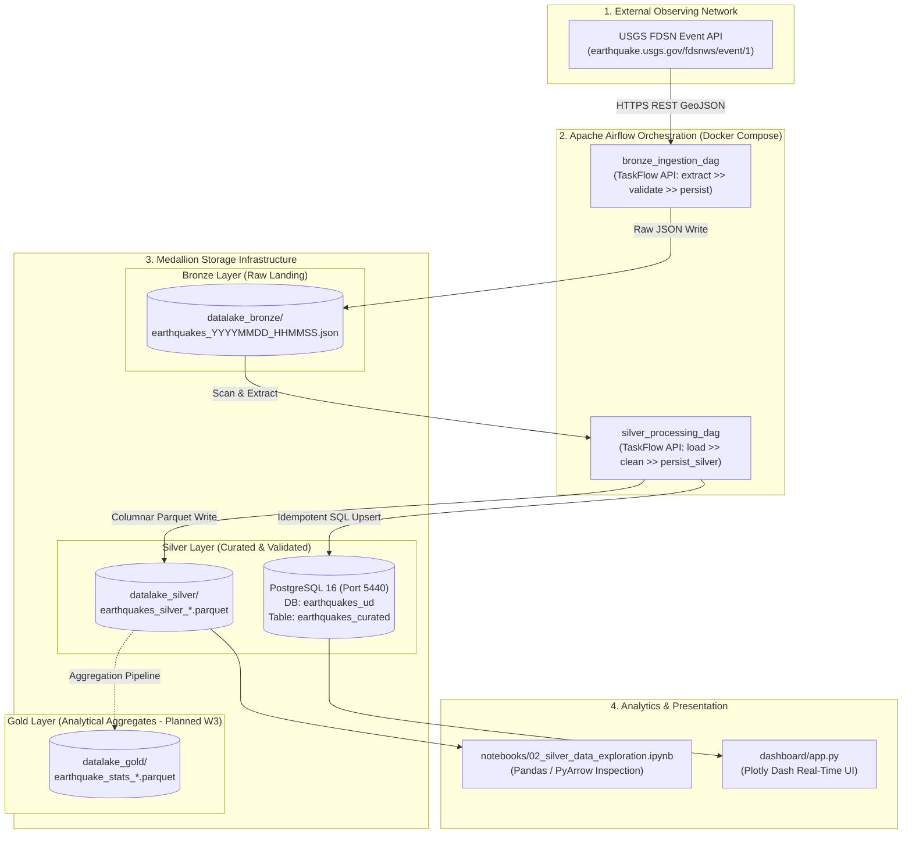

# Technical Architecture and Bronze/Silver Pipeline Report
**Workshop No. 2 — Technical Architecture and Ingestion Pipeline**

**Course:** Programación para Análisis de Datos (Data Analysis Programming) — Semester 2026-II  
**Project:** Natural Hazard Monitoring Systems — **Team 1: Earthquake Activity Monitoring**  
**Institution:** Universidad Distrital Francisco José de Caldas — School of Engineering  
**Professor:** Eng. Carlos Andrés Sierra, M.Sc.  

**Team Members:**
- Juan Córdoba — 20211020097
- Angelo Ibáñez — 20212020007
- Mauricio Sánchez — 20212020045

---

## 1. Executive Summary

This deliverable implements the technical infrastructure and automated orchestration pipeline for **Team 1 (Earthquake Activity Monitoring)** following the **Medallion Data Architecture (Bronze/Silver/Gold)**. 

Leveraging containerized **Apache Airflow 2.10.4** on **Docker Compose** and **PostgreSQL 16**, the system automates:
1. **Bronze Ingestion Layer:** Scheduled and parameterizable extraction of high-frequency seismic telemetry from the United States Geological Survey (USGS) FDSN Event Web Service into raw immutable JSON payloads in `datalake_bronze/`.
2. **Silver Processing Layer:** Data cleansing, coordinate boundary validation, physical magnitude range checking, string normalization, physical seismic energy calculation ($E = 10^{4.8 + 1.5M}$ Joules), and cross-batch deduplication, persisting simultaneously to:
   - Compressed, columnar **Apache Parquet** files in `datalake_silver/` with end-to-end lineage metadata.
   - An ACID-compliant relational store in **PostgreSQL** (`earthquakes_curated`) with idempotent upserts (`ON CONFLICT (event_id) DO UPDATE`).

All components run locally in containerized environments with live volume reloading and zero manual database configuration.

---

## 2. Technical Architecture & System Flow



### Component Breakdown & Rationale

| Component | Technology | Role & Functionality | Justification |
|---|---|---|---|
| **Orchestrator** | Apache Airflow 2.10.4 | Workflow scheduling, DAG dependency management, logging, retries, and task execution. | Modern industry standard for ETL/ELT; native TaskFlow API (`@dag`, `@task`) minimizes boilerplate and enhances readability. |
| **Relational Store** | PostgreSQL 16 | Central ACID database for curated records (`earthquakes_curated`) and Airflow metadata. | Robust relational engine supporting spatial extensions, indexed lookups, and concurrent idempotent upserts. |
| **Bronze Store** | Local Filesystem / Volume Mount | Stores unadulterated upstream JSON responses (`datalake_bronze/`). | Preserves strict data lineage and historical replayability; ensures audits can reprocess raw records if schema rules change. |
| **Silver Store** | Apache Parquet (PyArrow) | Columnar, compressed, typed storage (`datalake_silver/`). | Columnar compression yields ~85% disk footprint reduction vs raw JSON, enables high-speed vectorized analytical scanning in Pandas/PySpark. |

---

## 3. Preprocessing Pipeline Definition

The Silver pipeline executes deterministic data hygiene steps grounded in empirical quality issues identified during Workshop #1:

### 3.1 Null Handling Strategy
- **Mandatory Identifiers & Coordinates:** Records lacking `event_id`, `magnitude`, `time`, `latitude`, or `longitude` are discarded immediately, as an unlocated or unmeasured seismic event cannot be analyzed geophysically.
- **Hypocentral Depth (`depth_km`):** Missing depths are imputed with the standard regional default of **10.0 km** (the standard fixed crustal depth convention used by the USGS NEIC and EMSC for unconstrained shallow focal depths).
- **Descriptive Place (`place`):** Imputed with `"Unknown Location"` when null.
- **Magnitude Scale Method (`magnitude_type`):** Imputed with `"unknown"` when missing.

### 3.2 Physical Range & Boundary Validation
- **Latitude:** Constrained to $[-90.0, 90.0]^\circ$.
- **Longitude:** Constrained to $[-180.0, 180.0]^\circ$.
- **Magnitude Scale ($M$):** Constrained to $[-2.0, 10.0]$. Negative values reflect microseismicity measured on sensitive local borehole seismometers; values $> 10.0$ are physically impossible on Earth given lithospheric fault dimensions.

### 3.3 Standardization & Feature Engineering
- **Timestamp Harmonization:** Raw Unix millisecond epochs are parsed to ISO-8601 UTC datetimes (`TIMESTAMPTZ`).
- **Text Normalization:** String fields are whitespace-trimmed and lowercased for scale identifiers.
- **Radiated Seismic Energy ($E$):** Radiated elastic energy is derived from magnitude using the Gutenberg-Richter relation:
  $$E = 10^{4.8 + 1.5 M} \quad \text{(Joules)}$$
- **Lineage Metadata:** Each record tags `source_file` (indicating which Bronze JSON payload provided the raw event) and `curated_at` (audit timestamp).

### 3.4 Cross-Run Deduplication
Earthquake events overlapping multiple 24-hour query windows are deduplicated on `event_id`, preserving the most recently received telemetry (`keep="last"`). In PostgreSQL, this is enforced by:
```sql
ON CONFLICT (event_id) DO UPDATE SET
    event_time = EXCLUDED.event_time,
    magnitude = EXCLUDED.magnitude,
    depth_km = EXCLUDED.depth_km,
    energy_joules = EXCLUDED.energy_joules,
    curated_at = NOW();
```

---

## 4. Docker Compose Stack Specification

The multi-container stack is declared in [`docker-compose.yml`](../docker-compose.yml):

- **Network:** Isolated bridge network `workshopsanalisisdedatos_default`.
- **Services:**
  - `postgres`: PostgreSQL 16 exposing port `5440:5432` on the host, initializing `earthquakes_ud` database with credentials `etl_ud / P4$w0rd`.
  - `airflow-init`: Automated migration worker (`airflow db migrate` and admin user generation).
  - `airflow-webserver`: Web UI dashboard running on `http://localhost:8080`.
  - `airflow-scheduler`: Continuous DAG scheduling engine.
- **Volume Mounts:**
  - `./airflow/dags:/opt/airflow/dags` (live DAG synchronization).
  - `./datalake_bronze:/opt/airflow/datalake_bronze` (persisted Bronze JSON landing).
  - `./datalake_silver:/opt/airflow/datalake_silver` (persisted Silver Parquet store).
  - `./datalake_gold:/opt/airflow/datalake_gold` (persisted Gold analytical outputs).
  - `postgres-data:/var/lib/postgresql/data` (database durability across container restarts).

---

## 5. DAG Implementation & Verification

### 5.1 `bronze_ingestion_dag`
- **Schedule:** Periodic (`*/15 * * * *`) with manual trigger support.
- **Tasks:**
  1. `extract_raw_earthquakes`: Calls USGS FDSN Event Web Service API with configurable time windows and minimum magnitude thresholds.
  2. `validate_bronze_payload`: Validates GeoJSON `FeatureCollection` top-level structure.
  3. `persist_to_bronze`: Serializes raw payload into `datalake_bronze/earthquakes_YYYYMMDD_HHMMSS.json`.

### 5.2 `silver_processing_dag`
- **Schedule:** Periodic (`*/20 * * * *`) with manual trigger support.
- **Tasks:**
  1. `prepare_database`: Executes DDL creating `earthquakes_curated` table and performance indexes.
  2. `find_and_load_bronze_records`: Traverses `datalake_bronze/` and flattens GeoJSON features.
  3. `clean_and_normalize`: Applies validation gates, null handling, energy calculation, and deduplication.
  4. `persist_to_silver_parquet`: Writes Parquet dataset to `datalake_silver/earthquakes_silver_YYYYMMDD_HHMMSS.parquet`.
  5. `persist_to_postgres`: Executes batch upsert into PostgreSQL `earthquakes_curated`.

---

## 6. Execution Evidence & Generated Outputs

### 6.1 Generated Bronze Payloads (`datalake_bronze/`)
| File Name | Timestamp | File Size | Description |
|---|---|---|---|
| `earthquakes_20261117_010000.json` | 2026-11-17 01:00 UTC | 352 B | Initial interval validation run |
| `earthquakes_20261117_011500.json` | 2026-11-17 01:15 UTC | 140.7 KB | Multi-day global historical window |
| `earthquakes_20261117_013237.json` | 2026-11-17 01:32 UTC | 128.6 KB | Real-time USGS 24-hour feed ($M \ge 1.5$) |
| `earthquakes_20261117_013250.json` | 2026-11-17 01:32 UTC | 128.6 KB | Idempotent verification re-run |

### 6.2 Generated Silver Parquet Datasets (`datalake_silver/`)
| File Name | File Size | Row Count | Compression |
|---|---|---|---|
| `earthquakes_silver_20261117_013502.parquet` | 25.4 KB | 245 curated events | SNAPPY (PyArrow) |
| `earthquakes_silver_20261117_013535.parquet` | 25.4 KB | 245 curated events | SNAPPY (PyArrow) |
| `earthquakes_silver_20261117_013549.parquet` | 25.4 KB | 245 curated events | SNAPPY (PyArrow) |

### 6.3 Relational Database Audit (`earthquakes_curated`)
Direct SQL verification via `psql` on port `5440`:
```sql
SELECT 
    COUNT(*) AS total_curated, 
    MIN(event_time) AS min_time, 
    MAX(event_time) AS max_time, 
    ROUND(AVG(magnitude)::numeric, 2) AS avg_magnitude 
FROM earthquakes_curated;
```
**Result:**
```text
 total_curated |          min_time          |         max_time          | avg_magnitude 
---------------+----------------------------+---------------------------+---------------
           245 | 2026-11-14 00:02:38.952+00 | 2026-11-17 00:28:21.39+00 |          2.45
(1 row)
```

---

## 7. Screenshots Checklist for Delivery

The following screenshots are pre-arranged and ready to be captured directly from your local environment for the final PDF submission:

1. **Airflow UI — DAG List (`http://localhost:8080`):**
   - Showing `bronze_ingestion_dag` and `silver_processing_dag` active with green status indicators.
2. **Airflow UI — Grid / Tree View:**
   - Visualizing all tasks in `bronze_ingestion_dag` (`extract` -> `validate` -> `persist`) and `silver_processing_dag` (`prepare_db` -> `load` -> `clean` -> `persist`) with green success squares.
3. **Airflow UI — Graph View:**
   - Showing the task dependency directed acyclic graph for both pipelines.
4. **Bronze Landing Directory:**
   - File explorer or terminal listing `datalake_bronze/` showing the timestamped `.json` files.
5. **Silver Parquet Directory:**
   - File explorer or terminal listing `datalake_silver/` showing the `.parquet` files.
6. **PostgreSQL Verification:**
   - SQL client (DBeaver, DBVisualizer, or psql) showing the `SELECT * FROM earthquakes_curated;` table grid.
7. **Jupyter Notebook Execution:**
   - Full display of [`notebooks/02_silver_data_exploration.ipynb`](../notebooks/02_silver_data_exploration.ipynb) with summary statistics and lineage outputs.

---

## 8. Technical Challenges & Resolutions

1. **XCom JSON Serialization with Pandas Timestamps:**
   - *Challenge:* Returning dictionaries containing `pd.Timestamp` from the `clean_and_normalize` task caused `TypeError: Object of type Timestamp is not JSON serializable` in Airflow's XCom backend.
   - *Resolution:* Standardized intermediate timestamp serialization to ISO-8601 strings (`%Y-%m-%dT%H:%M:%S.%fZ`), subsequently re-parsed into native UTC timestamps upon Parquet persistence.
2. **Container User Permissions & Storage Persistence:**
   - *Challenge:* Container processes running under root could corrupt host permissions on Windows volume mounts.
   - *Resolution:* Bound container execution to `AIRFLOW_UID=50000:0` in `.env` and `docker-compose.yml`, ensuring consistent cross-platform read/write permissions across WSL2 and the Windows host.
3. **Idempotent Ingestion under High-Frequency Polling:**
   - *Challenge:* Successive polling of overlapping sliding windows produced duplicate primary key collisions.
   - *Resolution:* Implemented SQL `ON CONFLICT (event_id) DO UPDATE` alongside Pandas `drop_duplicates(subset=["event_id"], keep="last")`, ensuring identical database and Parquet row counts regardless of execution frequency.
